# SSB Digital: Junior DevOps / Web Operations Take-Home

A small Core PHP + MySQL application (student name / college records) set up, deployed, backed up and
troubleshot on a Linux server, covering assignment steps A to H.

| | |
|---|---|
| **Environment** | AWS EC2, Ubuntu 24.04 LTS |
| **Stack** | Apache 2.4.58, PHP 8.3.6, MySQL 8.0.46, phpMyAdmin |
| **Time spent** | approx. X hours |
| **Status** | Steps A to H complete (bonus items not attempted, see Limitations) |

## Repository layout

```
app/          PHP source: index.php (list + create), edit.php (update), health.php, bootstrap.php
database/     schema.sql, sample_data.sql, import_demo.sql, create_app_user.sql.example
scripts/      deploy.sh, backup.sh, restore.sh
docs/         security.md, incident-note.md
screenshots/  evidence for every step
.env.example  config template (the real .env is never committed)
```

## Prerequisites

- Ubuntu 24.04 server with sudo access and SSH
- Security group: port 22 and port 80 from the administrator's IP only. Port 3306 stays closed.

## A. LAMP setup and checks

```bash
sudo apt update && sudo apt upgrade -y
sudo apt install -y apache2 mysql-server php libapache2-mod-php php-mysql php-mbstring php-xml php-curl php-zip rsync git zip unzip
sudo systemctl enable --now apache2 mysql

# phpMyAdmin without interactive dialogs
echo "phpmyadmin phpmyadmin/dbconfig-install boolean true" | sudo debconf-set-selections
echo "phpmyadmin phpmyadmin/reconfigure-webserver multiselect apache2" | sudo debconf-set-selections
sudo DEBIAN_FRONTEND=noninteractive apt install -y phpmyadmin
sudo phpenmod mbstring && sudo systemctl restart apache2
```

MySQL root uses socket auth, so phpMyAdmin logs in with a separate admin account:

```sql
CREATE USER 'pma_admin'@'localhost' IDENTIFIED BY '<STRONG_PASSWORD>';
GRANT ALL PRIVILEGES ON *.* TO 'pma_admin'@'localhost' WITH GRANT OPTION;
```

| Task | Command |
|---|---|
| Status / start / stop | `sudo systemctl status\|start\|stop apache2 mysql` |
| Ports in use | `sudo ss -tulpn \| grep -E 'apache2\|mysqld'` (Apache 80, MySQL 127.0.0.1:3306) |
| Apache logs | `/var/log/apache2/error.log`, `access.log` |
| MySQL log | `/var/log/mysql/error.log` or `journalctl -u mysql` |
| PHP config | `/etc/php/8.3/apache2/php.ini` (`log_errors = On`, PHP errors go to the Apache error log). The CLI uses `/etc/php/8.3/cli/php.ini`. |
| Health check | `http://<EC2-PUBLIC-IP>/ssb-app/health.php` |


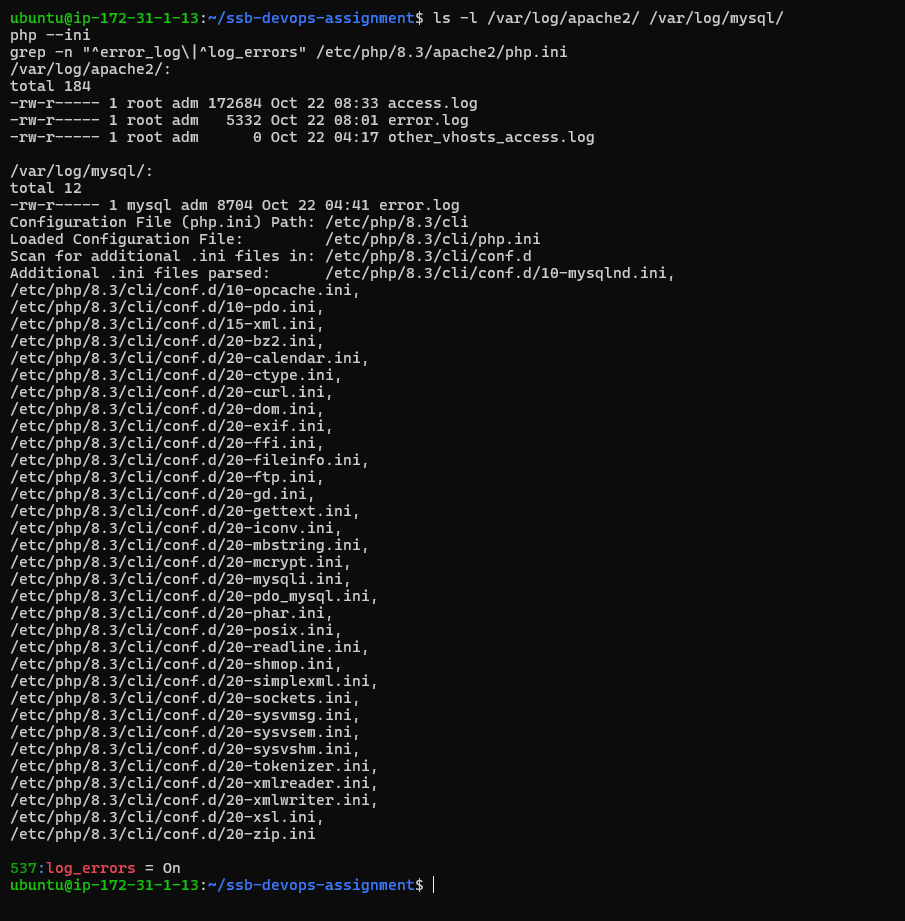
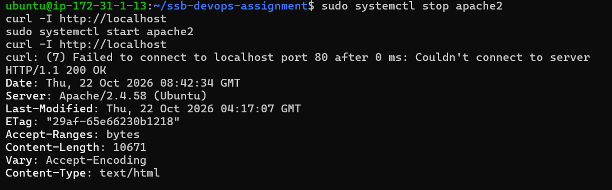
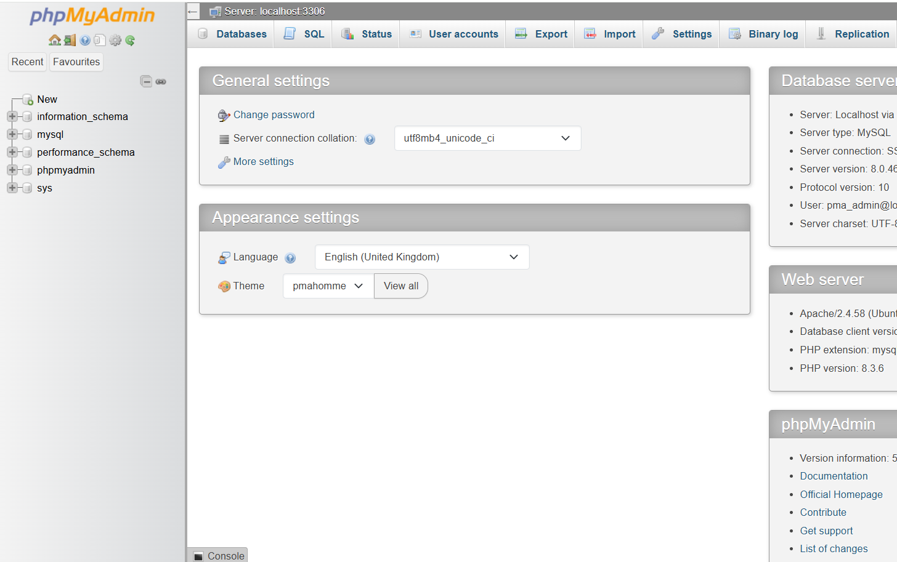

## B. Core PHP application

- `index.php` lists records from MySQL and creates a new one; `edit.php` updates one.
- Prepared statements (PDO), HTML escaping, CSRF token, and a generic error page for users.
  The real error goes to the Apache error log.
- Database settings are **not** in the source. They are read from `/etc/ssb-app/.env`
  (outside the web root), or `<repo>/.env` locally. Template: `.env.example`.

```bash
sudo mkdir -p /etc/ssb-app
sudo cp .env.example /etc/ssb-app/.env && sudo nano /etc/ssb-app/.env   # set DB_PASS
sudo chown root:www-data /etc/ssb-app /etc/ssb-app/.env
sudo chmod 750 /etc/ssb-app && sudo chmod 640 /etc/ssb-app/.env
```

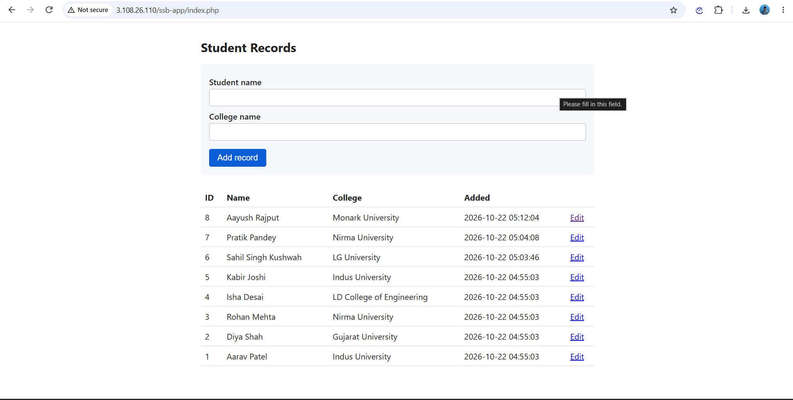

## C. MySQL and phpMyAdmin

```bash
sudo mysql < database/schema.sql          # database ssb_app + table students
sudo mysql < database/sample_data.sql     # 5 sample rows (run once)
sudo mysql -e "CREATE USER 'ssb_user'@'localhost' IDENTIFIED BY '<APP_PASSWORD>'; \
  GRANT SELECT, INSERT, UPDATE, DELETE ON ssb_app.* TO 'ssb_user'@'localhost'; FLUSH PRIVILEGES;"
```

- **Import** (phpMyAdmin → ssb_app → Import): `database/import_demo.sql` creates `departments` with 3 rows.
- **Export** (phpMyAdmin → ssb_app → Export → Custom → SQL): produces `CREATE TABLE` + `INSERT` statements.

| Statement | What it does |
|---|---|
| `SELECT` | Reads rows without changing anything |
| `INSERT` | Adds a new row |
| `UPDATE ... WHERE` | Changes matching rows (without `WHERE`, every row) |
| `DELETE ... WHERE` | Removes matching rows (without `WHERE`, the whole table) |

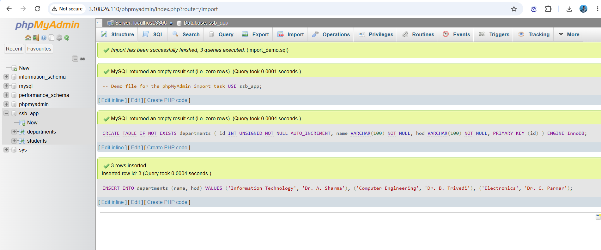
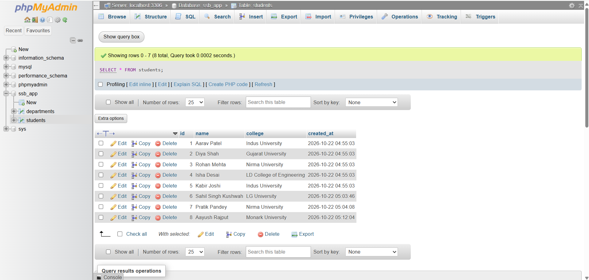
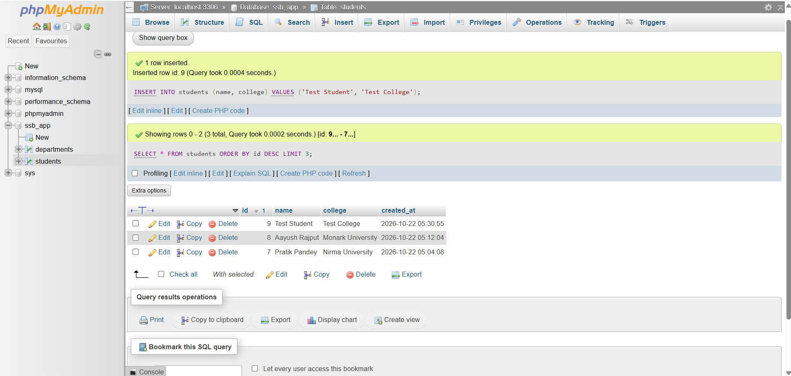
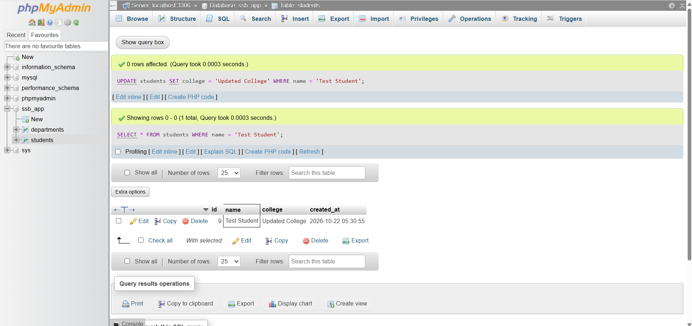
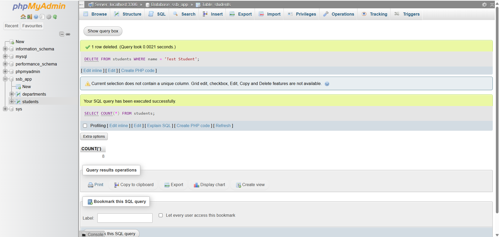

## D. Deployment with rsync

Source `app/` → target `/var/www/html/ssb-app/`. Always dry-run first:

```bash
sudo rsync -avhi --dry-run --delete --chown=root:www-data --chmod=D755,F644 \
  --exclude='.git' --exclude='.env' --exclude='*.log' --exclude='backups/' \
  app/ /var/www/html/ssb-app/
```

Run the same command without `--dry-run` to deploy. Excluded items never reach the server. A second run
transfers nothing; after an edit only the changed file is sent. `--delete` keeps the target an exact mirror.

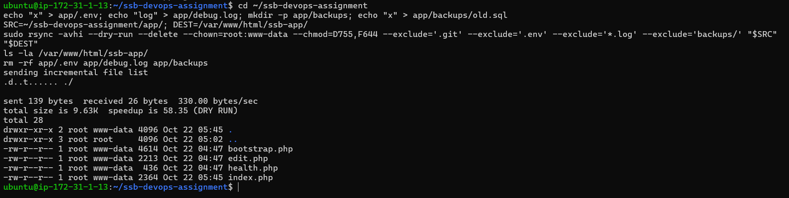
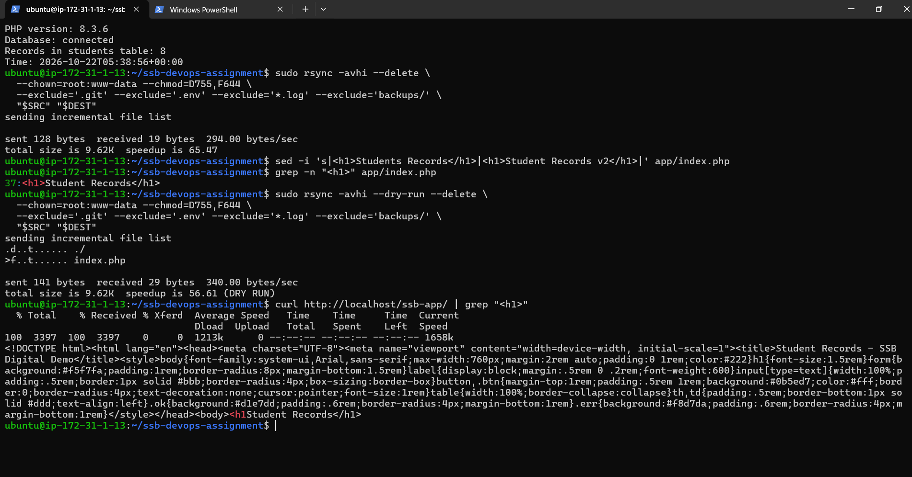
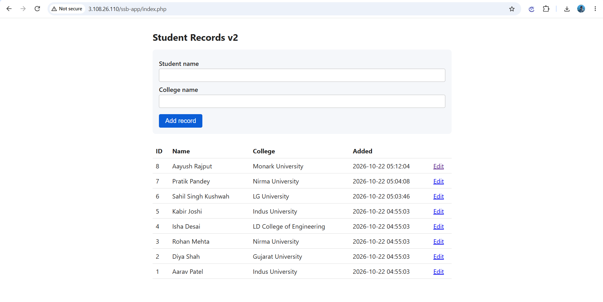

## E. Git and release flow

- `.gitignore` covers `.env`, logs, `backups/`, archives and editor files.
- Meaningful commit history; tags mark the tested releases.
- `scripts/deploy.sh` validates before it runs rsync (rsync installed, source files present, config file and
  keys present, DB password not the placeholder, PHP syntax OK, safe target path), shows a dry run, asks for
  confirmation, deploys, then runs a health check.

```bash
./scripts/deploy.sh --dry-run   # validate + preview
./scripts/deploy.sh             # validate, preview, confirm, deploy, health check
```

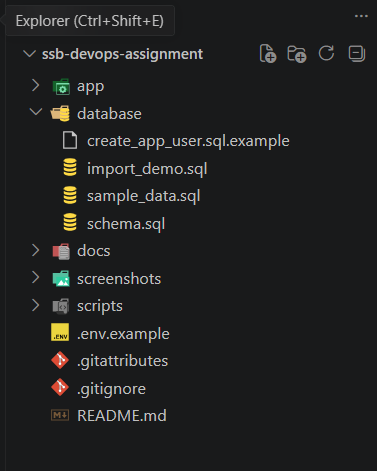
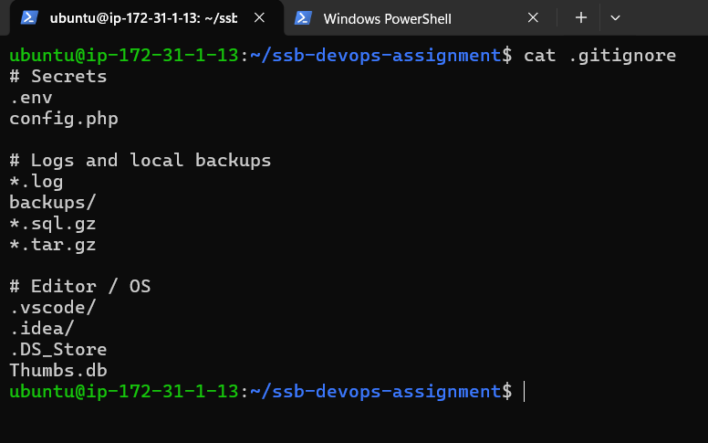
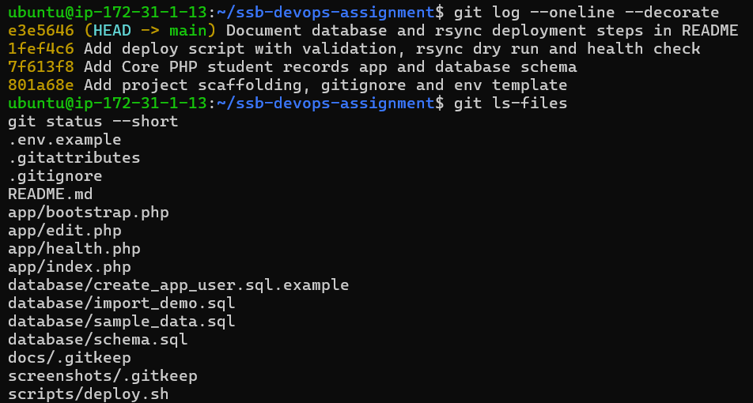
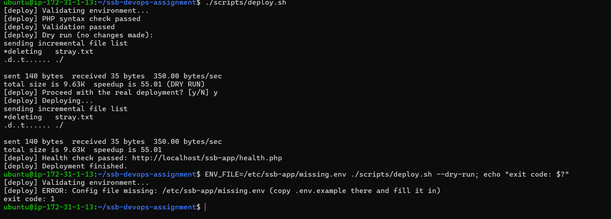

## F. Backup and restore

```bash
./scripts/backup.sh                               # DB dump + app files archive in backups/
./scripts/restore.sh backups/<file>.sql [test_db] # restore into a TEST database and verify row counts
```

Manual equivalents:

```bash
mysqldump -u ssb_user -p --single-transaction --no-tablespaces ssb_app > backups/ssb_app_manual.sql
tar -czf backups/app_files_manual.tar.gz -C /var/www/html ssb-app

sudo mysql -e "CREATE DATABASE ssb_app_restore_test CHARACTER SET utf8mb4 COLLATE utf8mb4_unicode_ci;"
sudo mysql ssb_app_restore_test < backups/ssb_app_manual.sql
sudo mysql -e "SELECT COUNT(*) FROM ssb_app_restore_test.students;"
```

The dump has no `CREATE DATABASE`/`USE` line, so a restore can never overwrite the live database.
`restore.sh` refuses to target the live database and compares row counts for every table.
`backups/` is git-ignored and never deployed.

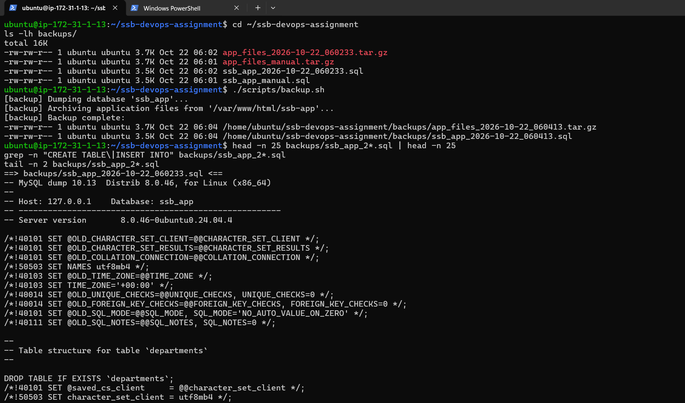
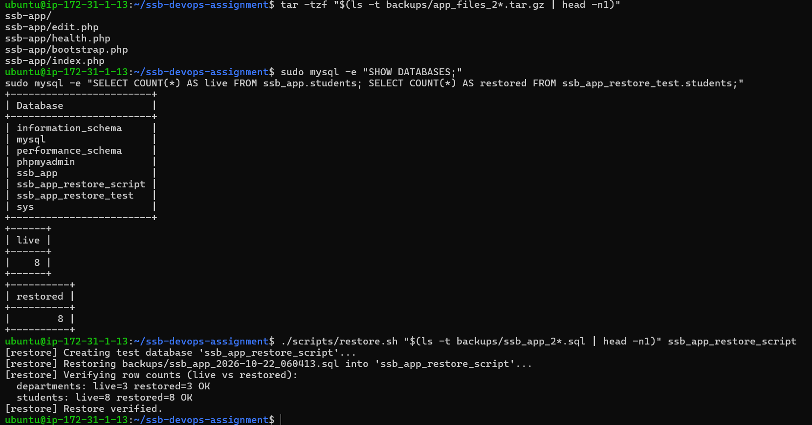
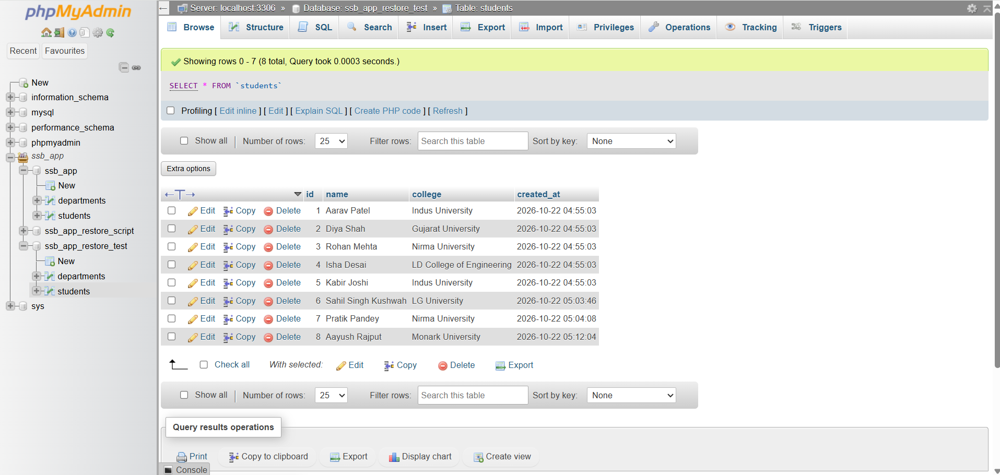

## G. Security and permissions

Full notes: [docs/security.md](docs/security.md).

- No secrets in Git (checked in files and history). `.env.example` has placeholders only.
- `/etc/ssb-app` 750 and `.env` 640 (`root:www-data`); app files 755/644 owned by root, so Apache can read
  but not modify them. Nothing is world-writable. `backups/` is 700.
- The app uses the least-privilege `ssb_user` (SELECT, INSERT, UPDATE, DELETE on `ssb_app.*`), never root.
- MySQL listens on 127.0.0.1 only; port 3306 is closed in the security group.

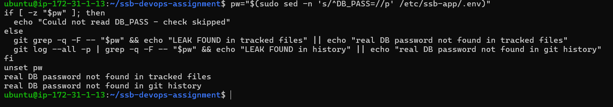
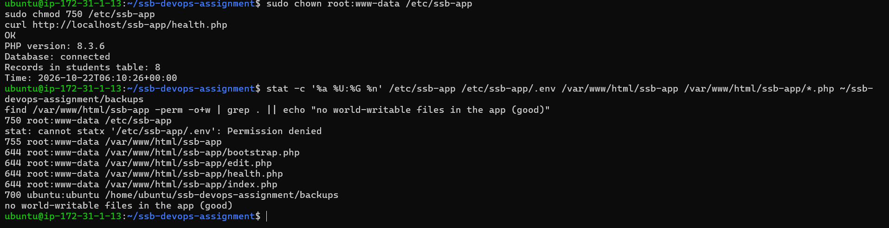
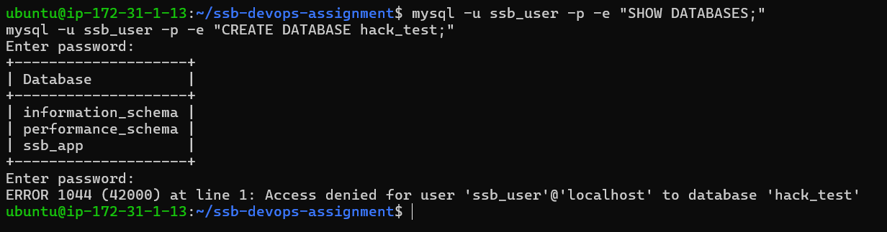
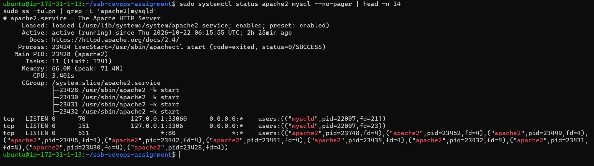

## H. Troubleshooting exercise

Incident note: [docs/incident-note.md](docs/incident-note.md).

**Scenario:** wrong database password in `/etc/ssb-app/.env`.

| Stage | Detail |
|---|---|
| Symptom | `health.php` returns HTTP 500, "Database connection failed" |
| Checks | Apache error log; `systemctl status mysql`; `ss -tulpn \| grep mysqld`; `mysqladmin ping`; `.env` modification time |
| Evidence | `[ssb-app] DB connection failed: SQLSTATE[HY000] [1045] Access denied for user 'ssb_user'@'localhost'` |
| Cause | `DB_PASS` in `.env` did not match the MySQL user's password |
| Fix | Restored the known-good `.env` (`cp -p`), health check back to 200 |

A second, real incident occurred after rotating the phpMyAdmin service account's password: phpMyAdmin reported
"Access denied for user 'phpmyadmin'" because MySQL and `/etc/phpmyadmin/config-db.php` held different passwords.
It was fixed by setting both from one generated value. Lesson: change a password in every place that uses it, together.


## Assumptions and known limitations

- Demo uses plain HTTP and sample data only; no real credentials or production data. A real deployment would add TLS.
- Backups are manual (script-driven). No scheduled cron job or retention rule yet.
- Bonus items not attempted: CI syntax check, Apache virtual host, cron backup with retention, health-check script.
- `restore.sh` verifies against the live database, so restoring an old backup after the data changed will report
  row-count differences.

## Submission note

Complete: steps A to H (setup, PHP app, MySQL + phpMyAdmin import/export, rsync deployment, Git release flow with
`deploy.sh`, backup and restore with verification, security and permissions, troubleshooting with an incident note).
Environment: AWS EC2, Ubuntu 24.04 (a Linux VM). Time spent: approx. X hours.
